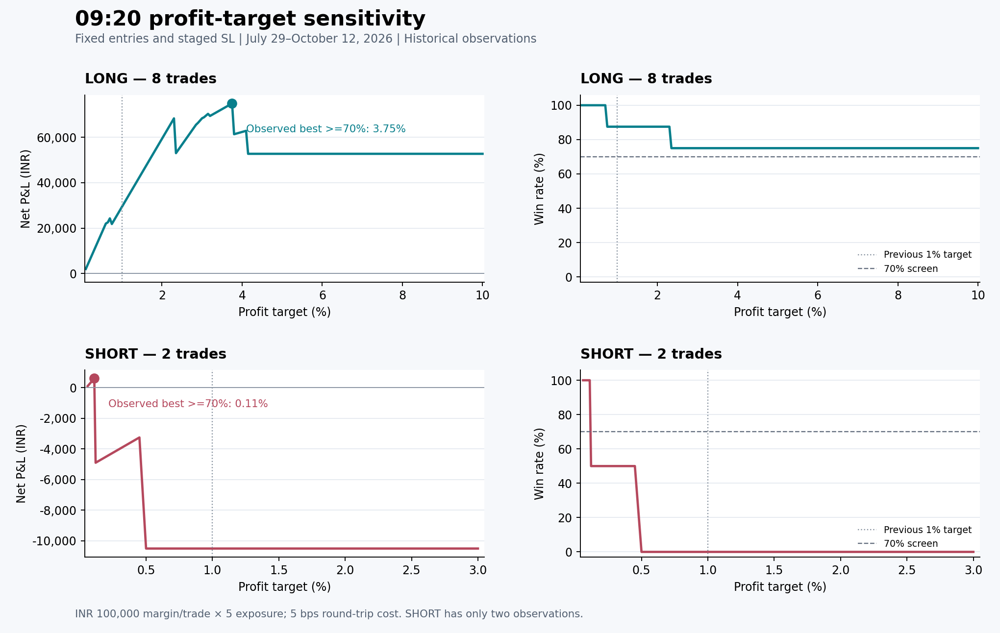

# G-3 09:20: best observed LONG and SHORT targets

**Best tested targets with at least 70% historical wins on each side:**
**LONG 3.75%** and **SHORT 0.11%**, on the fixed ten-trade entry configuration
from the preceding joint filter search. LONG wins 6/8 (75.00%) and earns
₹74,878.52 net; SHORT wins 2/2 (100%) and earns ₹600.00 net. Together they
earn **₹75,478.52 from ten added trades, with eight wins (80.00%)**.

These are tuned historical observations, not a validated live configuration.
SHORT has only two fills, and the combined recent October result is 1/2 wins
and −₹425.74. The LONG target also exceeds the current production contract's
3% maximum and was evaluated through an explicit research override. No live,
paper, dashboard, or published G-3 configuration was changed.

## Comparison with previous targets

All results cover the same 49 published sessions, July 29–October 12, 2026.
The selected entry pool remains eight LONG and two SHORT trades.

| Target pair: LONG / SHORT | LONG wins | SHORT wins | Added win rate | Added net P&L |
| --- | ---: | ---: | ---: | ---: |
| Original 0.97% / 2.67% | 7/8 | 0/2 | 70.00% | ₹17,903.43 |
| Previous 1.00% / 1.00% | 7/8 | 0/2 | 70.00% | ₹18,803.43 |
| Initial sweep winner: 3.00% / 0.10% | 6/8 | 2/2 | 80.00% | ₹68,839.73 |
| **Extended/refined winner: 3.75% / 0.11%** | **6/8** | **2/2** | **80.00%** | **₹75,478.52** |

The final pair improves net P&L by **₹56,675.10 versus 1%/1%**. The combined
G-3 portfolio becomes **122 executed trades, 88 wins (72.13%), and
₹362,160.68 net P&L**, versus the published baseline's 112 trades, 80 wins
(71.43%), and ₹286,682.16. The daily-equity maximum drawdown of the combined
portfolio remains ₹14,142.14. The added setup's drawdown is ₹5,297.51.
Existing G-3 trades are neither displaced nor changed by the chosen pair.

Rupee figures use the existing backtest sizing: **₹100,000 margin per entry,
5× exposure, ₹1,000,000 portfolio capital, and 5 bps round-trip costs**.
These are net results after the model's costs. A win means positive net P&L,
not necessarily a target hit: only two of the eight LONG trades hit 3.75%;
four other LONG wins come from profitable 15:15 time exits.

## Target sensitivity



| LONG target | Wins | Net P&L |
| --- | ---: | ---: |
| 0.70% | 8/8 | ₹24,279.16 |
| 1.00% | 7/8 | ₹29,303.43 |
| 3.00% — best within the native target cap | 6/8 | ₹68,339.73 |
| 3.65% | 6/8 | ₹73,878.52 |
| 3.70% | 6/8 | ₹74,378.52 |
| **3.75%** | **6/8** | **₹74,878.52** |
| 3.80% | 6/8 | ₹61,331.15 |
| 4.00% | 6/8 | ₹62,331.15 |
| 5.00%–10.00% | 6/8 | ₹52,705.58 |

The decline from 3.75% to 3.80% is driven mainly by GODFRYPHLP: it hits the
3.75% target, but at 3.80% it instead ends the day with about 0.99% gross
profit. The higher BOSCHLTD target offsets only a small part of that loss.
Thus 3.75% is a sharp historical peak, not evidence of a stable optimum.
No trade hits the 10% diagnostic target; the maximum favourable excursion
before the applicable exit on those paths is about 4.10%.

| SHORT target | Wins | Net P&L |
| --- | ---: | ---: |
| 0.09% | 2/2 | ₹400.00 |
| 0.10% | 2/2 | ₹500.00 |
| **0.11%** | **2/2** | **₹600.00** |
| 0.12% | 1/2 | −₹4,900.00 |
| 0.15% | 1/2 | −₹4,750.00 |
| 0.45% | 1/2 | −₹3,250.00 |
| 1.00% or 2.67% | 0/2 | −₹10,500.00 |

IOC moves only about 0.116% favourably on the saved path, explaining the
sharp change between 0.11% and 0.12%. At 0.11%, each winning SHORT earns
₹550 gross less ₹250 costs = **₹300 net**. The existing 1.25% initial stop
would cost approximately ₹6,500 including costs on this exposure. Two wins
do not establish a sustainable win rate for that payoff. The results retain
the native simulator's percentage price levels and fixed cost assumptions;
they are not a new live fill or tick-rounding validation.

## Earlier versus recent sessions

| Final 3.75% / 0.11% pair | Wins / fills | Win rate | Added net P&L |
| --- | ---: | ---: | ---: |
| Earlier 43 sessions through September 30 | 7/8 | 87.50% | ₹75,904.26 |
| Six recent sessions, October 5–12 | 1/2 | 50.00% | −₹425.74 |
| Full period | 8/10 | 80.00% | ₹75,478.52 |

Choosing targets from the earlier period instead favours **3.75% LONG /
0.45% SHORT**. That pair earns ₹77,604.26 on 7/8 earlier wins, then loses
both recent trades (−₹5,975.74), ending with 7/10 wins and ₹71,628.52.
The later preference for a 0.11% SHORT target uses information from those
recent outcomes. Neither the earlier nor recent sample reaches the ten-fill
validation minimum; SHORT also cannot meet the five-fill side minimum.

The input cohort and its prior outcomes have already been inspected. Opening
OI was recovered retrospectively, and availability at the historical live
decision time is unproven. The underlying export has 3,696 complete
stock-days across the 49 baseline sessions; 20 sessions have no valid 09:16
OI for any stock. Some early universe mappings are monthly reconstructions.
October 1 remains outside the published paired baseline. The targets should
therefore remain research candidates rather than live-approved defaults.

## Fixed rules and what was searched

Entry profile: `5m_reference_5m__1m_volume_180`. Five-minute LONG gates are
price ≥0.30%, OI rise ≥0.10%, and volume ≥3.0; SHORT price magnitude is
≥0.13% active / ≥0.20% core, OI rise ≥0.05%, and volume ≥1.5. The 09:21
confirmation uses body ≥0.75 LONG / ≥0.65 SHORT, directional wick ≤0.35,
and volume ≥1.8 on both sides. Entries first become possible at 09:22.

The **SL remains 1.25%, tightening to 1% after 120 minutes**, with square-off
at 15:15. Ranking, quotas, source checks, costs, capital, and portfolio rules
are unchanged. Only profit targets vary.

The first stage tests 61 targets on each side (0.10%–3.00% in 0.05-point
steps plus the original 0.97% and 2.67%), replaying all **3,721 pairs**.
Because both best targets landed at the range boundaries, a second stage
extends LONG through 10% in 0.05-point steps and refines SHORT from 0.06%
through 0.20% in 0.01-point steps. There are **201 tested LONG target values
and 73 SHORT values**, with 159 additional portfolio checks, including seed
and finalist checks. The second stage optimises each side separately and
then replays the chosen pair together; it is not a complete 201×73 grid.
Best means highest observed net P&L among side results with at least 70%
wins. All entries and their fills were required to match across targets.

## Artifacts and verification

Initial complete pair sweep:
`C:\TradingData\eqidv2\backtesting_result_v13_v10_g_3\research_0920\runs\2026-10-13\target_sweep_20261013T0010`.

Final extended/refined results:
`C:\TradingData\eqidv2\backtesting_result_v13_v10_g_3\research_0920\runs\2026-10-13\target_boundary_20261013T0030`.

The final folder contains `long_target_sweep.csv`, `short_target_sweep.csv`,
`additional_target_pairs.csv`, and `summary.json`. The
`best_pair_both_sides_observed_70_*` files contain the final orders, full G-3
trade ledger, and daily comparison; `diagnostic_discovery_pair_small_sample_70_*`
contains the earlier-period choice. Each stage has its own plan, source
evidence, and artifact/code SHA-256 manifest. Both sets of hashes verified,
and the published backtest pointer hash remains unchanged. The 1% reference
reproduces the previous saved ledger exactly. All **66 focused tests passed**.

Reproduce into new directories:

```powershell
python -m research.g3_0920_target_sweep --output-dir C:\TradingData\eqidv2\backtesting_result_v13_v10_g_3\research_0920\runs\2026-10-13\target_sweep_NEW
python -m research.g3_0920_target_boundary_check --parent C:\TradingData\eqidv2\backtesting_result_v13_v10_g_3\research_0920\runs\2026-10-13\target_sweep_NEW --output-dir C:\TradingData\eqidv2\backtesting_result_v13_v10_g_3\research_0920\runs\2026-10-13\target_boundary_NEW
```
